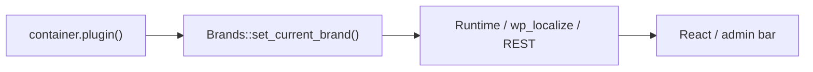

# Brand-agnostic implementation plan (onboarding + editor-chat)

This document describes the cross-module initiative to make **wp-module-onboarding** and **wp-module-editor-chat** work for any Newfold host-brand plugin, not only Bluehost.

**Terminology:** *Brand-agnostic* means **multi-brand** (Bluehost, HostGator, Web.com, Crazy Domains, etc.), not “git branch.”

**Onboarding eligibility (option A):** Enable the onboarding module for every brand slug defined in `Brands::get_brands()`, with the active brand resolved from the **module loader container** (same approach as `wp-module-help-center`).

## Git workflow

| Repo | Branch |
|------|--------|
| wp-module-onboarding | `feature/brand-agnostic-onboarding` |
| wp-module-editor-chat | `feature/brand-agnostic-editor-chat` |

Start from up-to-date `main`, then open **one PR per repo** (e.g. title: *Make module brand-agnostic*).

## Reference patterns (other modules)

Use these as the source of truth—do not reinvent brand resolution:

| Module | What to reuse |
|--------|----------------|
| **help-center** | `Brands::set_current_brand( $container )` in bootstrap |
| **reset** | `BrandConfig::get_brand_id()`, `get_brand_name()` from `container()->plugin()` |
| **ai-chat** | `brand_id` for handshake/API + `mm_brand` fallback |
| **host plugin runtime** | `window.NewfoldRuntime.plugin.brand` in JS when needed |

Onboarding already has `Brands.php` and `Runtime::current_brand()` on `window.nfdOnboarding.runtime.currentBrand`. The gaps were bootstrap/eligibility, legacy `Bluehost` PHP, and hardcoded UI.

---

## wp-module-onboarding (this repo)

### 1. Bootstrap and brand constant

In `bootstrap.php` (register callback):

- Call **`Brands::set_current_brand( $container )`** so `NFD_ONBOARDING_PLUGIN_BRAND` is always set (normalized slug, e.g. `hostgator-us`).
- Keep **`NFD_ONBOARDING_BLUEHOST_BRAND`** only as backward compatibility (raw `plugin->brand`).

### 2. ModuleController — eligibility

In `includes/ModuleController.php`:

- Use **`BrandConfig::get_brand_slug()`** instead of `Bluehost::get_current_brand()`.
- **`is_brand_eligible()`:** `BrandConfig::is_known_brand( $brand )` → key exists in `Brands::get_brands()` (not only `bluehost` / `bluehost-india`).
- Keep transient / query param `nfd_module_onboarding_activate` unchanged.

### 3. PHP refactor

Replace `Data\Bluehost` with **`includes/Data/BrandConfig.php`**:

- `get_brand_slug()`, `get_plugin_dashboard_page()`, `get_dashboard_redirect_params()`, `is_known_brand()`.

Update consumers: `Plugins.php`, `WP_Admin.php`, `ExternalRedirectInterceptor.php`.

Remove `Bluehost.php`; replace `BluehostDataWPUnitTest` with **`BrandConfigWPUnitTest`**.

### 4. Frontend

- **`BrandLogo`** component: `currentBrand` from store / `window.nfdOnboarding.runtime`, assets under `src/Brands/`, link `currentBrand.url`, alt via `sprintf` + `currentBrand.name`.
- Replace hardcoded header in `src/app/index.js`.
- Fix Design Studio text domains where still using `wp-plugin-bluehost`.

### 5. Tests and build

- WPUnit: eligibility across `Brands::get_brands()` keys.
- `composer test`, PHPCS, `npm run build` → commit `build/<version>/`.

---

## wp-module-editor-chat (sibling repo)

### 1. PHP

- **`includes/Data/BrandConfig.php`:** `get_brand_id()`, `get_brand_name()`, portal URLs, filter **`nfd_editor_chat_brand_links`**.
- **`ChatEditor.php`:** handshake `brand_id`, admin bar title, `nfdEditorChat.brand` in `wp_localize_script`.

### 2. React / styles

- `BrandDropdownMenu`, `BrandIcon`, `nfd-editor-chat__brand-menu` CSS.
- Sidebar: `sprintf( '%s AI Assistant', brand.name )`.

### 3. Tests and build

- `BrandConfigWPUnitTest`, `npm run build`, commit `build/<version>/`.

---

## Documentation and PRs

| File | Purpose |
|------|---------|
| `docs/integration.md` | Multi-brand behavior |
| `docs/overview.md` (onboarding) | Product scope |
| `docs/development.md` (editor-chat) | Test on non-Bluehost plugins |
| `AGENTS.md` | No hardcoded “Bluehost” in UI |
| **`docs/pr-brand-agnostic.md`** | English GitHub PR body template |

## Execution order

1. Pull `main`; create feature branches.
2. Onboarding: bootstrap → BrandConfig → ModuleController → PHP → BrandLogo → tests/docs/build.
3. Editor-chat: BrandConfig → localize → React/CSS → build → tests/docs.
4. Manual smoke on Lando (symlinked vendor modules).
5. Open PRs using `docs/pr-brand-agnostic.md`.
